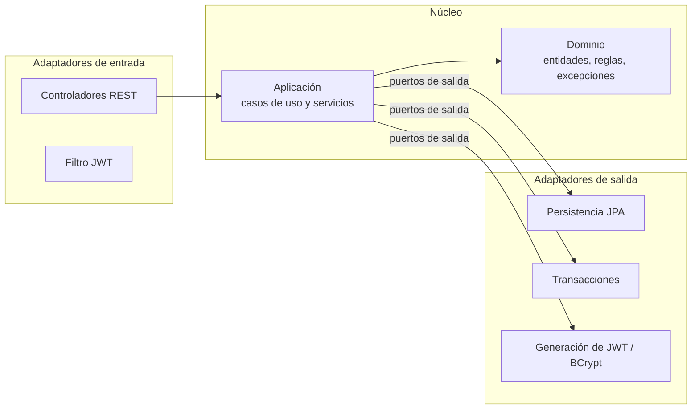
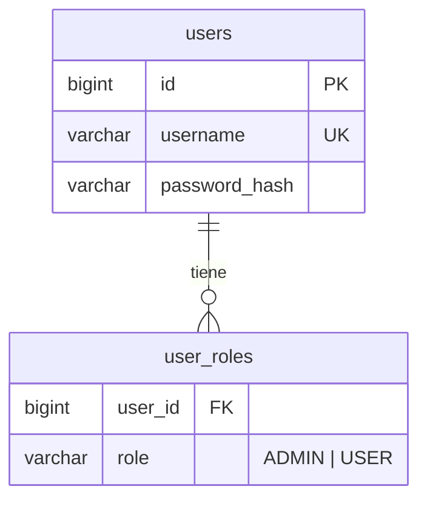
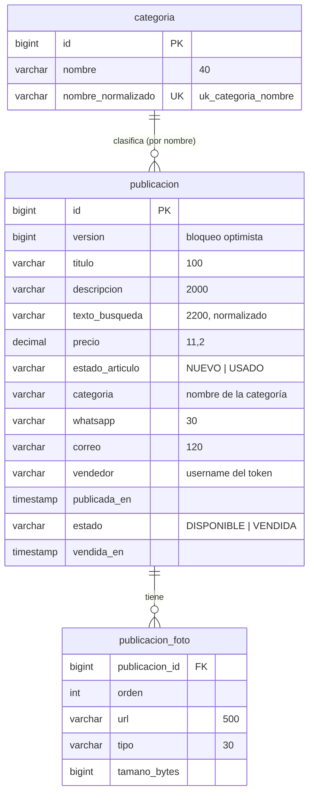

# UPMarket — Descripción completa del proyecto

> **Proyecto Integrador (código 167410) · Universidad de Pamplona, sede Villa del Rosario · Grupo 4**
> Documento elaborado el 7 de noviembre de 2026 a partir del anteproyecto, el backlog, las historias de usuario, el cronograma y el código de los dos repositorios en GitHub.

---

## Contenido

1. [Qué es UPMarket](#1-qué-es-upmarket)
2. [Problema, objetivos e hipótesis](#2-problema-objetivos-e-hipótesis)
3. [Alcance](#3-alcance)
4. [Equipo y roles](#4-equipo-y-roles)
5. [Requisitos e historias de usuario](#5-requisitos-e-historias-de-usuario)
6. [Arquitectura general](#6-arquitectura-general)
7. [Repositorio 1: Auth-Core-UpMarket](#7-repositorio-1-auth-core-upmarket)
8. [Repositorio 2: UpMarket (domain-service)](#8-repositorio-2-upmarket-domain-service)
9. [Integración entre los dos servicios (JWT)](#9-integración-entre-los-dos-servicios-jwt)
10. [Modelo de datos](#10-modelo-de-datos)
11. [API REST completa](#11-api-rest-completa)
12. [Reglas de negocio](#12-reglas-de-negocio)
13. [Pruebas](#13-pruebas)
14. [Cómo ejecutar el proyecto](#14-cómo-ejecutar-el-proyecto)
15. [Historial de los repositorios](#15-historial-de-los-repositorios)
16. [Planeación: cronograma, iteraciones y tablero](#16-planeación-cronograma-iteraciones-y-tablero)
17. [Estado actual y pendientes](#17-estado-actual-y-pendientes)

---

## 1. Qué es UPMarket

UPMarket es una **plataforma web de compraventa entre estudiantes** de la Universidad de Pamplona. Permite que un estudiante **publique** un artículo (producto, emprendimiento o artículo usado) y que otro lo **encuentre** por categoría, palabra clave o filtros, para luego **contactar** al vendedor y acordar la compra fuera de la plataforma.

UPMarket no procesa pagos ni envíos: centraliza y ordena las ofertas que hoy se pierden en los grupos de WhatsApp.

| Dato | Valor |
|---|---|
| Tipo de sistema | Aplicación web con backend en microservicios |
| Usuarios | Estudiantes (rol `USER`) y administrador (rol `ADMIN`) |
| Servicios backend | **AuthCore** (autenticación) y **domain-service-upmarket** (mercado) |
| Repositorios | [DiegoAndres4/Auth-Core-UpMarket](https://github.com/DiegoAndres4/Auth-Core-UpMarket) y [DiegoAndres4/UpMarket](https://github.com/DiegoAndres4/UpMarket) |
| Arquitectura | Hexagonal (puertos y adaptadores) en ambos servicios |
| Lenguaje | Java (Spring Boot) |
| Frontend | Planeado en React con Vite y Tailwind CSS (aún no existe en GitHub) |

---

## 2. Problema, objetivos e hipótesis

### Problema

En la sede Villa del Rosario los estudiantes compran y venden artículos a través de grupos de WhatsApp. Las ofertas se mezclan con mensajes ajenos, no tienen categorías ni filtros, y desaparecen rápido del chat. Esto reduce la visibilidad de lo que se vende y hace que compradores y vendedores no se encuentren a tiempo.

### Objetivo general

Desarrollar una plataforma web que permita a los estudiantes **publicar, buscar y contactar** para la comercialización de sus productos y emprendimientos, de manera centralizada y organizada por categorías.

### Hipótesis de solución

> Si se implementa UPMarket, una plataforma web para la publicación, búsqueda y contacto para la compraventa de artículos entre estudiantes de la sede Villa del Rosario, entonces se reducirá el tiempo que tarda un estudiante en localizar una oferta específica frente a los grupos de WhatsApp, y al menos el 70 % de los participantes de la prueba piloto calificará la organización de las ofertas como mejor que la actual, porque las publicaciones estarán centralizadas, clasificadas por categorías y accesibles mediante filtros de búsqueda, sin mezclarse con mensajes ajenos.

**Cómo se verifica (Unidad 3):** en la prueba piloto se cronometra la búsqueda de los mismos artículos en WhatsApp y en UPMarket, y se aplica una encuesta corta de percepción.

### Viabilidad

| Tipo | Resumen |
|---|---|
| Técnica | El equipo tiene bases en Java, POO y bases de datos; aprende Spring Boot, arquitectura hexagonal y React durante el semestre. |
| Operativa | 5 integrantes con roles definidos, dedicación estimada de 6 h/semana por persona, alcance acotado. |
| Económica | Sin inversión: herramientas gratuitas y de código abierto, despliegue en planes gratuitos. |

---

## 3. Alcance

**Incluido**

- Registro e inicio de sesión (AuthCore).
- Publicar artículos con título, descripción, precio, estado (nuevo o usado), categoría, hasta 5 fotos y contacto.
- Categorías iniciales y creación de categorías por el administrador.
- Búsqueda por palabra clave y filtros combinados (categoría, rango de precio, estado).
- Ver el detalle de un artículo y pedir el contacto del vendedor (WhatsApp y/o correo).
- Gestionar las propias publicaciones: editar, marcar como vendida, eliminar y ver "mis publicaciones".

**Fuera del alcance**

- Pasarela de pagos (la compra se acuerda entre las partes; puede quedar como trabajo futuro).
- Verificación de identidad o registro exclusivo con correo institucional.
- Moderación de publicaciones por el administrador.
- Almacenamiento de los archivos de las fotos dentro del backend (solo se guarda su URL).

---

## 4. Equipo y roles

| Integrante | Rol |
|---|---|
| Diego Andrés Becerra Bonilla | Backend |
| Didier André Vesga Fuentes | Backend |
| Carla Daniela Martínez Panqueva | Frontend |
| Emanuel Jared Velandia Narváez | Despliegue y base de datos |
| Darwin Oswaldo Merchán Durán | Pruebas y documentación |

---

## 5. Requisitos e historias de usuario

### Product Backlog

| Ítem | Requerimiento | Servicio |
|---|---|---|
| RF-1 a RF-4 | Registro, inicio de sesión, asignación de roles y listado de usuarios | AuthCore |
| RNF-5 a RNF-7 | Seguridad de contraseñas, tokens JWT y persistencia | AuthCore |
| **RF-8** | Publicación de artículos | UpMarket |
| **RF-9** | Gestión de categorías | UpMarket |
| **RF-10** | Búsqueda y filtros | UpMarket |
| **RF-11** | Detalle y contacto del vendedor | UpMarket |
| **RF-12** | Gestión de mis publicaciones | UpMarket |

Las historias HU-1 a HU-7 corresponden a AuthCore. Las cinco historias principales del mercado son:

| Historia | Como un… | Necesito… | Con la finalidad de… | Prioridad | Puntos (días) | Iteración |
|---|---|---|---|---|---|---|
| **HU-8** Publicar un artículo | estudiante vendedor | publicar un artículo con título, descripción, precio, estado, categoría y fotos | darlo a conocer en un espacio organizado | 10 | 8 | 1 · S6–S8 |
| **HU-9** Explorar por categorías | estudiante comprador | ver las publicaciones organizadas por categorías | encontrar rápido artículos del tipo que me interesa | 8 | 3 | 2 · S8–S9 |
| **HU-10** Buscar y filtrar | estudiante comprador | buscar por palabra clave y filtrar por categoría, precio y estado | localizar una oferta en menos tiempo que en WhatsApp | 9 | 5 | 3 · S9–S10 |
| **HU-11** Ver detalle y contactar | estudiante comprador | ver el detalle de un artículo y el contacto del vendedor | acordar la compra con el vendedor | 8 | 3 | 4 · S10–S11 |
| **HU-12** Gestionar mis publicaciones | estudiante vendedor | editar, marcar como vendido o eliminar mis publicaciones | mantener actualizado lo que ofrezco | 7 | 5 | 5 · S11–S12 |

### Criterios de aceptación (escenarios)

**HU-8 · Publicar un artículo**
1. Publicación exitosa: con sesión y datos válidos, se guarda como `DISPONIBLE` y aparece en su categoría.
2. Campos obligatorios vacíos: no se guarda y se listan todos los campos faltantes.
3. Precio inválido (≤ 0 o con letras): se rechaza.
4. Imagen no permitida (no JPG/PNG, más de 5 MB o más de 5 fotos): se rechaza.

**HU-9 · Explorar por categorías**
1. Listado de categorías con la cantidad de publicaciones disponibles.
2. Publicaciones de una categoría, más recientes primero.
3. Categoría sin publicaciones: mensaje informativo.
4. El ADMIN crea una categoría; si el nombre ya existe, 409.

**HU-10 · Buscar y filtrar**
1. Palabra clave en título y descripción, sin distinguir mayúsculas ni tildes.
2. Filtros combinados de categoría, rango de precio y estado.
3. Sin resultados: mensaje y opción de limpiar filtros.
4. Precio mínimo mayor que el máximo: 400.

**HU-11 · Ver detalle y contactar**
1. Detalle con fotos, título, descripción, precio, estado, categoría, fecha y vendedor.
2. Contacto del vendedor (WhatsApp y correo) en una acción aparte.
3. Sin sesión: no se muestra el contacto (401).
4. Artículo vendido: se ve, pero no se puede contactar (409).

**HU-12 · Gestionar mis publicaciones**
1. El autor edita precio o descripción.
2. Marcar como vendido: sale de las búsquedas y queda en su historial.
3. Eliminar con confirmación (borrado definitivo).
4. Publicación de otro usuario: 403.

---

## 6. Arquitectura general

UPMarket está formado por dos servicios backend independientes, cada uno con su propia base de datos, y un frontend web que consume a ambos. Los dos servicios comparten una **clave secreta** para firmar y validar los tokens JWT, de modo que UpMarket valida los tokens **localmente**, sin llamar a AuthCore en cada petición.

```mermaid
flowchart LR
    U[Estudiante / Administrador<br/>navegador] --> FE[Frontend React<br/>Vite + Tailwind<br/>(planeado)]
    FE -- "POST /api/auth/register<br/>POST /api/auth/login" --> AC[AuthCore<br/>Spring Boot 4.1.1 · :8081]
    AC -- "JWT (sub, uid, roles)" --> FE
    FE -- "Authorization: Bearer JWT" --> DS[domain-service-upmarket<br/>Spring Boot 3.5.6 · :8084]
    AC --- DB1[(MySQL<br/>authcore_db)]
    DS --- DB2[(H2 en desarrollo<br/>MySQL en producción)]
    AC -. "clave JWT compartida" .- DS
```

### Arquitectura hexagonal

Ambos servicios siguen la arquitectura hexagonal (puertos y adaptadores):



- **Dominio:** reglas de negocio puras, sin Spring ni JPA.
- **Aplicación:** casos de uso (puertos de entrada) e interfaces de lo que necesita del exterior (puertos de salida).
- **Infraestructura:** implementaciones concretas (REST, JPA, seguridad, configuración).
- Las dependencias siempre apuntan hacia el núcleo. En UpMarket esto se verifica automáticamente con ArchUnit.

### Tecnologías

| Componente | AuthCore | domain-service-upmarket |
|---|---|---|
| Java | 21 | 17 |
| Spring Boot | 4.1.1 | 3.5.6 |
| Construcción | Gradle | Maven |
| Persistencia | Spring Data JPA + MySQL | Spring Data JPA + H2 (dev) / MySQL (prod) |
| Seguridad | Spring Security, BCrypt, JJWT 0.12.6 | Spring Security, JJWT 0.12.6 |
| Validación | Jakarta Validation | Validación en el dominio |
| Pruebas | JUnit 5 | JUnit 5, MockMvc, ArchUnit 1.3.0 |
| Contenedores | Dockerfile + docker-compose | No tiene |
| Puerto | 8081 | 8084 |

**Frontend y despliegue planeados:** React + Vite + Tailwind CSS; frontend en Vercel; backend y base de datos en AWS; Git y GitHub; IntelliJ IDEA y VS Code; Postman para probar la API.

---

## 7. Repositorio 1: Auth-Core-UpMarket

**URL:** https://github.com/DiegoAndres4/Auth-Core-UpMarket · **Rama:** `main` · **Paquete base:** `com.pamplona.authcore`

Servicio de autenticación y autorización. Es el servicio base del curso, compartido entre grupos: registra usuarios, inicia sesión y emite un JWT con el nombre de usuario, su id y sus roles.

### Estructura de archivos

```
Auth-Core-UpMarket/
├── Dockerfile                    # build con gradle:8.10-jdk21, ejecución con eclipse-temurin:21-jre
├── docker-compose.yml            # MySQL 8.4 + authcore-service
├── build.gradle                  # Spring Boot 4.1.1, Java 21
├── settings.gradle               # rootProject = authcore-service
├── gradlew, gradlew.bat, gradle/wrapper/
└── src/
    ├── main/java/com/pamplona/authcore/
    │   ├── AuthcoreServiceApplication.java
    │   ├── domain/
    │   │   ├── User.java                     # entidad pura: id, username, passwordHash, roles
    │   │   └── Role.java                     # enum ADMIN, USER
    │   ├── application/
    │   │   ├── exception/                    # InvalidCredentials, UserAlreadyExists, UserNotFound
    │   │   ├── ports/in/                     # RegisterUser, Login, AssignRole, ListUsers (casos de uso)
    │   │   ├── ports/out/                    # UserRepositoryPort, PasswordHasherPort, TokenProviderPort
    │   │   └── service/AuthService.java      # implementa los 4 casos de uso
    │   └── infrastructure/
    │       ├── adapters/in/rest/
    │       │   ├── AuthController.java       # /api/auth/...
    │       │   ├── GlobalExceptionHandler.java
    │       │   └── dto/                      # Register/Login/AssignRole requests y respuestas
    │       ├── adapters/out/persistence/     # UserJpaEntity, UserJpaRepository, UserRepositoryJpaAdapter
    │       ├── adapters/out/security/        # BCryptPasswordHasherAdapter, JwtTokenProviderAdapter
    │       └── config/
    │           ├── SecurityConfig.java       # rutas públicas y protegidas
    │           ├── JwtAuthenticationFilter.java
    │           └── AdminBootstrapRunner.java # crea el usuario admin al arrancar
    ├── main/resources/application.yml
    └── test/java/.../AuthcoreServiceApplicationTests.java   # contextLoads
```

### Funcionamiento

| Caso de uso | Qué hace |
|---|---|
| Registrar | Rechaza usernames repetidos (409), guarda la contraseña con BCrypt y asigna el rol `USER`. |
| Iniciar sesión | Verifica la contraseña y devuelve un JWT. Credenciales inválidas: 401. |
| Asignar rol | Solo ADMIN. Agrega un rol a un usuario existente (404 si no existe). |
| Listar usuarios | Solo ADMIN. Devuelve id, username y roles. |
| Admin inicial | Al arrancar, si no existe, crea `admin` con roles `ADMIN` y `USER`. |

### Endpoints

| Método y ruta | Acceso | Cuerpo | Respuesta |
|---|---|---|---|
| `POST /api/auth/register` | Público | `{ "username", "password" }` (password ≥ 6) | 201 `{ id, username }` · 400 · 409 |
| `POST /api/auth/login` | Público | `{ "username", "password" }` | 200 `{ token }` · 401 |
| `POST /api/auth/users/{id}/roles` | ADMIN | `{ "role": "ADMIN" \| "USER" }` | 204 · 404 |
| `GET /api/auth/users` | ADMIN | — | 200 `[ { id, username, roles } ]` |

### Token JWT emitido

| Claim | Contenido |
|---|---|
| `sub` | username |
| `uid` | id numérico del usuario |
| `roles` | lista, por ejemplo `["USER"]` o `["ADMIN","USER"]` (sin prefijo `ROLE_`) |
| `iat` / `exp` | emisión y vencimiento (1 hora por defecto) |

La firma es HMAC con la clave `authcore.jwt.secret` (variable `JWT_SECRET`), tomada como texto en UTF-8. El algoritmo lo elige JJWT según la longitud de la clave: 32–47 bytes → HS256, 48–63 → HS384, 64 o más → HS512.

### Configuración

| Variable | Uso | Valor por defecto en el repo |
|---|---|---|
| `SPRING_DATASOURCE_URL` | Conexión MySQL | `jdbc:mysql://localhost:3306/authcore_db` |
| `SPRING_DATASOURCE_USERNAME` / `PASSWORD` | Credenciales MySQL | `root` / `1312` |
| `JWT_SECRET` | Clave compartida del JWT | Texto de ejemplo "cambia-este-secreto…" |
| `authcore.jwt.expiration-ms` | Duración del token | 3 600 000 (1 hora) |

Las tablas son `users` y `user_roles`, creadas por Hibernate (`ddl-auto: update`).

---

## 8. Repositorio 2: UpMarket (domain-service)

**URL:** https://github.com/DiegoAndres4/UpMarket · **Rama:** `main` · **Artefacto:** `com.upmarket:domain-service-upmarket:0.1.0-SNAPSHOT` · **Paquete base:** `com.upmarket.catalogo`

Servicio del dominio del mercado: publicaciones, categorías, búsqueda, contacto y gestión del vendedor (HU-8 a HU-12). No guarda usuarios: confía en el JWT de AuthCore.

### Estructura de archivos

```
UpMarket/
├── README.md                 # descripción, endpoints, reglas y pendientes
├── pom.xml                   # Spring Boot 3.5.6, Java 17, JJWT, H2, MySQL, ArchUnit
├── requests.http             # peticiones de ejemplo para probar a mano
├── .gitignore
└── src/
    ├── main/java/com/upmarket/catalogo/
    │   ├── DomainServiceApplication.java
    │   ├── domain/
    │   │   ├── model/
    │   │   │   ├── Publicacion.java          # entidad principal con su comportamiento
    │   │   │   ├── Categoria.java            # nombre + clave normalizada; 6 iniciales
    │   │   │   ├── Foto.java                 # url, tipo, tamaño; JPG/PNG ≤ 5 MB
    │   │   │   ├── Contacto.java             # WhatsApp y/o correo
    │   │   │   ├── Precio.java               # validación de precios
    │   │   │   ├── Texto.java                # normaliza sin tildes ni mayúsculas
    │   │   │   ├── Actor.java                # quien llama (username + roles)
    │   │   │   ├── Rol.java                  # ADMIN, USER
    │   │   │   ├── EstadoArticulo.java       # NUEVO, USADO
    │   │   │   └── EstadoPublicacion.java    # DISPONIBLE, VENDIDA
    │   │   ├── service/PoliticaAcceso.java   # quién puede hacer qué
    │   │   └── exception/                    # 9 excepciones de negocio
    │   ├── application/
    │   │   ├── port/in/
    │   │   │   ├── PublicacionUseCase.java   # HU-8, 10, 11, 12
    │   │   │   ├── CategoriaUseCase.java     # HU-9
    │   │   │   ├── CategoriaResumen.java
    │   │   │   └── command/                  # PublicarCommand, EditarPublicacionCommand, BuscarQuery, FotoComando
    │   │   ├── port/out/
    │   │   │   ├── PublicacionRepositoryPort.java
    │   │   │   ├── CategoriaRepositoryPort.java
    │   │   │   ├── FiltroPublicacion.java
    │   │   │   └── TransaccionPort.java
    │   │   └── service/
    │   │       ├── PublicacionService.java
    │   │       ├── CategoriaService.java
    │   │       └── Validacion.java
    │   └── infrastructure/
    │       ├── adapters/in/rest/
    │       │   ├── PublicacionController.java
    │       │   ├── CategoriaController.java
    │       │   ├── ActorActual.java          # convierte el usuario del token en Actor
    │       │   ├── RestExceptionHandler.java # excepciones → códigos HTTP
    │       │   └── dto/                      # requests y responses
    │       ├── adapters/out/persistence/
    │       │   ├── PublicacionJpaEntity.java, FotoEmbeddable.java
    │       │   ├── CategoriaJpaEntity.java
    │       │   ├── PublicacionSpringJpaRepository.java, CategoriaSpringJpaRepository.java
    │       │   ├── PublicacionRepositoryJpaAdapter.java, CategoriaRepositoryJpaAdapter.java
    │       │   └── TransaccionSpringAdapter.java
    │       ├── security/
    │       │   ├── SecurityConfig.java
    │       │   ├── JwtAuthenticationFilter.java
    │       │   ├── JwtTokenValidator.java
    │       │   ├── JwtProperties.java
    │       │   └── UsuarioAutenticado.java
    │       └── config/BeanConfig.java        # raíz de composición y categorías iniciales
    ├── main/resources/
    │   ├── application.yml                   # H2 en memoria, puerto 8084
    │   └── application-prod.yml              # MySQL
    └── test/java/com/upmarket/catalogo/      # ver sección 13
```

| Capa | Archivos |
|---|---|
| `domain` | 20 |
| `application` | 14 |
| `infrastructure` | 26 |
| Pruebas (`src/test`) | 19 |

### Dominio

| Clase | Responsabilidad |
|---|---|
| `Publicacion` | Nace `DISPONIBLE`; valida título, descripción, precio, fotos y contacto; `editar`, `marcarVendida` y `contactoDisponible` rechazan operaciones sobre una publicación vendida. |
| `Categoria` | Nombre de 2 a 40 caracteres; su identidad es la clave normalizada ("libros" = "Libros"). Iniciales: Tecnología, Libros, Útiles académicos, Alimentos, Servicios, Otros. |
| `Foto` | URL obligatoria (≤ 500 caracteres), tipo `image/jpeg` o `image/png`, tamaño de 1 byte a 5 MB. |
| `Contacto` | Al menos un medio: WhatsApp de 7 a 15 dígitos (con `+` opcional) y/o correo válido (≤ 120 caracteres). |
| `Precio` | Mayor que 0 y hasta 999 999 999.99, con 2 decimales. Para filtros acepta 0. |
| `Texto` | Normaliza texto: sin tildes, en minúsculas y con espacios simples. |
| `Actor` | Usuario que llama; acepta roles `ADMIN` o `ROLE_ADMIN` e ignora roles desconocidos. |
| `PoliticaAcceso` | Solo ADMIN crea categorías; solo el autor edita, vende o elimina (ni el ADMIN puede). |

**Excepciones de negocio y su código HTTP:**

| Excepción | HTTP |
|---|---|
| `ValorInvalidoException` | 400 |
| `AccesoDenegadoException` | 403 |
| `PublicacionNoEncontradaException`, `CategoriaNoEncontradaException` | 404 |
| `CategoriaDuplicadaException`, `EstadoInvalidoException` | 409 |
| Conflictos de concurrencia (`@Version`, restricción única) | 409 |
| Cualquier otro error | 500, sin detalles internos |

### Aplicación

- `PublicacionService` implementa publicar, buscar, detalle, contacto, mis publicaciones, editar, marcar vendida y eliminar. En cada operación valida en este orden: datos obligatorios (400) → existencia (404) → permiso (403) → estado (409).
- `CategoriaService` crea categorías (solo ADMIN), las lista con su conteo de publicaciones disponibles y asegura las iniciales al arrancar.
- `Validacion` reporta **todos** los campos obligatorios que faltan, no solo el primero.
- Las transacciones se piden por el puerto `TransaccionPort`, y el reloj (`Clock`) se inyecta con la zona `America/Bogota`.

### Infraestructura

- **REST:** dos controladores que solo traducen HTTP a casos de uso; los permisos los decide el dominio.
- **Persistencia JPA:** tablas `categoria`, `publicacion` y `publicacion_foto`. La búsqueda es una consulta JPQL con filtros opcionales, ordenada de la más reciente a la más antigua; los comodines `%` y `_` se escapan.
- **Concurrencia:** `UNIQUE (nombre_normalizado)` en categorías (traducido a 409 con el mensaje "La categoría '<nombre>' ya existe") y `@Version` en publicaciones (bloqueo optimista, 409).
- **Seguridad:** sesión sin estado, CSRF desactivado, `POST /api/categorias` solo para ADMIN, el resto de `/api/categorias/**` y `/api/publicaciones/**` para cualquier usuario autenticado, y todo lo demás denegado.

---

## 9. Integración entre los dos servicios (JWT)

```mermaid
sequenceDiagram
    participant E as Estudiante (frontend)
    participant A as AuthCore :8081
    participant D as domain-service :8084
    E->>A: POST /api/auth/login {username, password}
    A-->>E: 200 {token} (sub, uid, roles, exp)
    E->>D: POST /api/publicaciones + Authorization: Bearer token
    D->>D: Valida firma y vencimiento con la clave compartida
    D->>D: roles → ROLE_USER / ROLE_ADMIN; vendedor = sub
    D-->>E: 201 publicación creada
```

| Aspecto | AuthCore emite | UpMarket lee |
|---|---|---|
| Usuario | `sub` | `getSubject()`; si viene vacío, la petición queda sin autenticar (401) |
| Id | `uid` | Lo lee, pero el dominio identifica al vendedor por `username` |
| Roles | `roles: ["USER","ADMIN"]` | Agrega `ROLE_` (o lo respeta si ya viene) para `hasRole('ADMIN')` |
| Vencimiento | `exp` (1 h) | Lo valida con 30 s de tolerancia |
| Algoritmo | HMAC, según el largo de la clave | Acepta HS256, HS384 y HS512 |
| Clave | `JWT_SECRET` como **texto** | `JWT_SECRET_BASE64` como **Base64** |

**Importante:** las dos claves deben representar los mismos bytes. `JWT_SECRET_BASE64` se obtiene así:

```bash
echo -n "$JWT_SECRET" | base64 -w0
```

Si no coinciden, todas las peticiones a UpMarket responden 401.

---

## 10. Modelo de datos

### AuthCore (MySQL `authcore_db`)



### domain-service-upmarket (H2 / MySQL `upmarket`)



Las dos bases son independientes: UpMarket no tiene tabla de usuarios. El vendedor se guarda como el `username` que viene en el token.

---

## 11. API REST completa

### domain-service-upmarket (`http://localhost:8084`)

Todas las rutas requieren `Authorization: Bearer <token de AuthCore>`.

| Método y ruta | Historia | Quién | Respuestas |
|---|---|---|---|
| `GET /api/categorias` | HU-9 | Autenticado | 200 `[ { nombre, disponibles } ]` |
| `POST /api/categorias` | HU-9 | ADMIN | 201 · 400 · 403 · 409 (nombre repetido sin importar tildes ni mayúsculas) |
| `POST /api/publicaciones` | HU-8 | Autenticado | 201 · 400 (lista todos los faltantes) · 404 (categoría) |
| `GET /api/publicaciones?texto&categoria&precioMin&precioMax&estado` | HU-10 | Autenticado | 200 (solo disponibles, más recientes primero) · 400 |
| `GET /api/publicaciones/mias` | HU-12 | Autenticado | 200 (todas las propias, vendidas incluidas) |
| `GET /api/publicaciones/{id}` | HU-11 | Autenticado | 200 (sin contacto) · 404 |
| `GET /api/publicaciones/{id}/contacto` | HU-11 | Autenticado | 200 `{ whatsapp, correo }` · 404 · 409 (vendida) |
| `PUT /api/publicaciones/{id}` | HU-12 | Solo el autor | 200 · 400 · 403 · 404 · 409 (vendida) |
| `POST /api/publicaciones/{id}/sold` | HU-12 | Solo el autor | 200 · 403 · 404 · 409 (ya vendida) |
| `DELETE /api/publicaciones/{id}` | HU-12 | Solo el autor | 204 · 403 · 404 |

**Ejemplo de publicación (`POST /api/publicaciones`):**

```json
{
  "titulo": "Calculadora científica",
  "descripcion": "Casio fx-991, casi nueva",
  "precio": "50000",
  "estado": "USADO",
  "categoria": "Tecnología",
  "fotos": [ { "url": "https://archivos.example/calculadora.jpg", "tipo": "image/jpeg", "tamanoBytes": 200000 } ],
  "whatsapp": "3001234567",
  "correo": "vendedor@correo.com"
}
```

**Respuesta de una publicación:** `id`, `titulo`, `descripcion`, `precio`, `estadoArticulo`, `categoria`, `fotos`, `vendedor`, `publicadaEn`, `estadoPublicacion`, `vendidaEn`. El contacto no se incluye; se pide aparte.

**Formato de error:**

```json
{ "status": 409, "error": "Conflict", "mensaje": "La categoría 'Deportes' ya existe", "detalles": [] }
```

Sin token o con un token inválido, la respuesta es `401 {"status":401,"mensaje":"No autenticado: falta un token válido"}`. Sin permiso de rol: `403`.

### AuthCore (`http://localhost:8081`)

Ver la tabla de la [sección 7](#endpoints).

---

## 12. Reglas de negocio

- **Roles:** `USER` es cualquier estudiante y `ADMIN` administra las categorías. Solo el ADMIN crea categorías.
- **Autoría:** editar, vender y eliminar son solo del autor; ni el ADMIN puede (no hay moderación).
- **Vendedor:** sale del token, nunca del cuerpo de la petición.
- **Ciclo de vida:** la publicación nace `DISPONIBLE` y pasa a `VENDIDA` una sola vez. Vendida ya no se edita ni se contacta y sale de las búsquedas, pero sigue en "mis publicaciones".
- **Eliminar:** borrado físico y definitivo.
- **Textos:** título de 3 a 100 caracteres y descripción de 5 a 2000.
- **Precio:** número mayor que 0 y hasta 999 999 999.99; llega como texto y lo valida el dominio.
- **Fotos:** hasta 5, JPG o PNG, máximo 5 MB. Se guarda la URL y los metadatos, no el archivo.
- **Contacto:** WhatsApp y/o correo, al menos uno. Se entrega aparte y solo mientras la publicación está disponible.
- **Categorías:** identificadas por el nombre normalizado; la base de datos tiene una restricción única como última defensa.
- **Búsqueda:** palabra clave en título y descripción sin importar tildes ni mayúsculas; filtros combinables de categoría, rango de precio (inclusivo) y estado. Una categoría inexistente devuelve una lista vacía.
- **Orden de validación:** 400 → 404 → 403 → 409.
- **Concurrencia:** si dos administradores crean la misma categoría a la vez, una recibe 201 y la otra 409. Si dos operaciones modifican la misma publicación a la vez, la segunda recibe 409.

---

## 13. Pruebas

### domain-service-upmarket

| Archivo | Tipo | Qué verifica |
|---|---|---|
| `domain/PublicacionTest` | Unitaria (9) | Publicar, textos, precio, fotos, contacto, editar, vender, búsqueda, categoría |
| `domain/PoliticaAccesoTest` | Unitaria (3) | Permisos de ADMIN y de autor; mapeo de roles del `Actor` |
| `application/PublicacionServiceTest` | Unitaria (16) | HU-8, 10, 11 y 12 con repositorios en memoria |
| `application/CategoriaServiceTest` | Unitaria (4) | Iniciales, conteo, creación y permisos (HU-9) |
| `contract/*RepositoryContractTest` | Contrato | Mismo comportamiento del repositorio en memoria y del JPA |
| `infrastructure/adapters/out/persistence/*JpaContractTest` | Integración JPA | Contrato contra H2, restricción única de categoría y bloqueo optimista |
| `infrastructure/security/JwtTokenValidatorTest` | Unitaria (6) | Token válido, vencido, otra clave, texto inválido, sin firma y sin clave |
| `infrastructure/adapters/in/rest/UpmarketRestTest` | Punta a punta (10) | HTTP → casos de uso → dominio → H2, con JWT real |
| `architecture/ArquitecturaHexagonalTest` | ArchUnit (8 reglas) | El dominio y la aplicación no dependen de la infraestructura ni de frameworks |

**Pruebas de `UpmarketRestTest`:**

1. Sin credenciales o con token falso: 401.
2. Categorías: iniciales, creación solo ADMIN, duplicada 409, rutas fuera de `/api` denegadas.
3. Publicar: 201 con el vendedor del token; faltantes 400; precio inválido; categoría inexistente.
4. Buscar: palabra clave sin tildes, filtros combinados, solo disponibles, rango inválido 400.
5. Detalle sin contacto; contacto aparte; vendida 409; inexistente 404.
6. Gestión del autor: 403 también para el ADMIN; 404 antes que 403; vendida no se edita (409).
7. Mis publicaciones: solo las propias, vendidas incluidas.
8. Concurrencia de categorías: dos administradores con hilos reales; resultado 201 y 409, mensaje "La categoría '<nombre>' ya existe", sin detalles de la base de datos.
9. Concurrencia de publicaciones: dos solicitudes simultáneas de marcar vendida; resultado 200 y 409.

Según el último commit (6 de noviembre de 2026), **`mvn verify` pasa con 81 de 81 pruebas**.

### AuthCore

Solo tiene `AuthcoreServiceApplicationTests.contextLoads`, que necesita MySQL encendido para pasar.

---

## 14. Cómo ejecutar el proyecto

### 1. Clave JWT compartida

```bash
export JWT_SECRET="<clave larga y aleatoria>"              # para AuthCore
export JWT_SECRET_BASE64=$(echo -n "$JWT_SECRET" | base64 -w0)   # para UpMarket
```

Nunca se guarda en el repositorio.

### 2. AuthCore (puerto 8081)

```bash
cd Auth-Core-UpMarket
docker compose up --build       # MySQL 8.4 + servicio
# o, con MySQL local en 3306:
./gradlew bootRun
```

### 3. domain-service-upmarket (puerto 8084)

```bash
cd UpMarket
mvn verify                      # pruebas
mvn spring-boot:run             # H2 en memoria
# producción:
SPRING_PROFILES_ACTIVE=prod DB_URL=jdbc:mysql://<host>:3306/upmarket DB_USER=<usuario> DB_PASSWORD=<clave> mvn spring-boot:run
```

Al arrancar se crean las categorías iniciales que falten.

### 4. Probar

1. `POST http://localhost:8081/api/auth/register` y luego `/api/auth/login` para obtener el token.
2. Usar el token en las peticiones de `requests.http` contra `http://localhost:8084`.
3. Para crear categorías, iniciar sesión con el usuario `admin` que crea AuthCore al arrancar.

---

## 15. Historial de los repositorios

| Fecha | Repositorio | Autor | Commit |
|---|---|---|---|
| 2026-11-06 | UpMarket | Daniela | Sprint 1: adaptadores de persistencia JPA, puertos de salida y pruebas de concurrencia (81/81 pruebas) |
| 2026-10-24 | UpMarket | DiegoAndres04 | Commit inicial: dominio y arquitectura hexagonal |
| 2026-10-24 | Auth-Core-UpMarket | DiegoAndres04 | Primer commit |

**Detalle del commit del 6 de noviembre:**

- Corrigió el `.gitignore` (`out/` → `/out/`), que impedía subir los paquetes `port/out` y `adapters/out`.
- Agregó los puertos de salida: `CategoriaRepositoryPort`, `PublicacionRepositoryPort`, `TransaccionPort` y `FiltroPublicacion`.
- Implementó la persistencia JPA: entidades, repositorios Spring Data, adaptadores y transacciones.
- Agregó las pruebas de contrato JPA con bloqueo optimista (`@Version`).
- Agregó las pruebas de concurrencia de categorías (201 contra 409) y de publicaciones.
- Cambió el mensaje del 409 de categorías a "La categoría '<nombre>' ya existe".
- El filtro JWT ahora respeta los roles que ya vienen con prefijo `ROLE_`.
- La regla de ArchUnit de puertos de salida ahora acepta records (para `FiltroPublicacion`).

---

## 16. Planeación: cronograma, iteraciones y tablero

| Fase | Actividad | Responsable | Semanas |
|---|---|---|---|
| Planeación | Anteproyecto completo | Todo el equipo | S5 |
| Planeación | Cronograma, Gantt y tablero Trello | Todo el equipo | S5–S6 |
| Planeación | Enfoque de desarrollo y riesgos (PMBOK) | Todo el equipo | S6 |
| Diseño | Arquitectura hexagonal del domain-service | Backend | S6–S7 |
| Diseño | Modelo de base de datos | Emanuel Velandia | S6–S7 |
| Diseño | Prototipos de interfaz | Carla Martínez | S6–S7 |
| Despliegue | Configuración de entornos (GitHub, Vercel, AWS, BD) | Emanuel Velandia | S7–S8 |
| Pruebas | Plan de pruebas y criterios de aceptación | Darwin Merchán | S7 |
| Desarrollo | Integración con AuthCore (JWT) | Backend | S7–S8 |
| Desarrollo | HU-8 Publicar un artículo | Backend + Frontend | S6–S8 |
| Desarrollo | HU-9 Categorías | Backend + Frontend | S8–S9 |
| Desarrollo | HU-10 Búsqueda y filtros | Backend + Frontend | S9–S10 |
| Desarrollo | HU-11 Detalle y contacto | Backend + Frontend | S10–S11 |
| Desarrollo | HU-12 Gestión de mis publicaciones | Backend + Frontend | S11–S12 |
| Pruebas | Pruebas funcionales por módulo | Darwin Merchán | S8–S12 |
| Despliegue | Versión estable | Emanuel Velandia | S12 |
| Validación | Prueba piloto con estudiantes | Darwin Merchán + equipo | S13 |
| Validación | Evaluación de resultados e hipótesis | Todo el equipo | S14 |
| Cierre | Documentación final y socialización | Darwin Merchán + equipo | S14–S15 |

- **Iteraciones:** medidas en semanas del semestre; una por historia (HU-8 a HU-12).
- **Puntos:** 1 punto = 1 día de trabajo.
- **Tablero de Trello:** [UPMarket – Proyecto Integrador (Grupo 4)](https://trello.com/b/GFSslZhB/upmarket-proyecto-integrador-grupo-4), con listas Backlog, Por hacer, En progreso, En revisión / pruebas y Hecho; una tarjeta por actividad, y las historias con sus criterios de aceptación como lista de chequeo.

**Sprint 1 (semana 7):** HU-8 entregada; validación de la infraestructura de HU-9 a HU-12, `mvn verify` y prueba de concurrencia de categorías (riesgo del dominio "Incertidumbre" del PMBOK). Según el commit del 6 de noviembre, quedó resuelto.

---

## 17. Estado actual y pendientes

### Estado

| Componente | Estado |
|---|---|
| AuthCore | Completo y funcional; pruebas mínimas |
| domain-service: dominio y aplicación | Completo (HU-8 a HU-12) |
| domain-service: persistencia, REST y seguridad | Completo desde el 6 de noviembre; 81/81 pruebas según el commit |
| Frontend | No existe todavía |
| Despliegue | No configurado |

### Pendientes

1. **Frontend en React:** login y registro contra AuthCore, y pantallas de HU-8 a HU-12 contra el domain-service.
2. **CORS:** ninguno de los dos servicios permite peticiones desde otro dominio; hay que habilitar el del frontend (localhost:5173 y el dominio de Vercel).
3. **Almacenamiento de fotos:** el backend solo guarda la URL. Hay que subir los archivos a un servicio (S3 o Cloudinary) y enviar la URL.
4. **Seguridad de AuthCore:** mover a variables de entorno la contraseña por defecto del admin (`admin123`), la de MySQL y la clave JWT, y cambiarlas.
5. **Docker del domain-service:** crear su Dockerfile y un docker-compose con MySQL, AuthCore y domain-service.
6. **Base de datos:** el código usa MySQL, pero el anteproyecto menciona PostgreSQL; hay que unificar los documentos.
7. **Pruebas de AuthCore:** perfil H2 para pruebas y pruebas de HU-1 a HU-7.
8. **README de AuthCore** y actualizar el README del domain-service, que aún dice que la infraestructura está "sin ejecutar".
9. **Confirmar con el docente:** que el contacto se guarde en la publicación, que el ADMIN no modere y que el borrado sea definitivo.
10. **Ejercicios propuestos por el README:** adaptador real de fotos, moderación por el ADMIN, paginación de la búsqueda y perfil público del vendedor.
